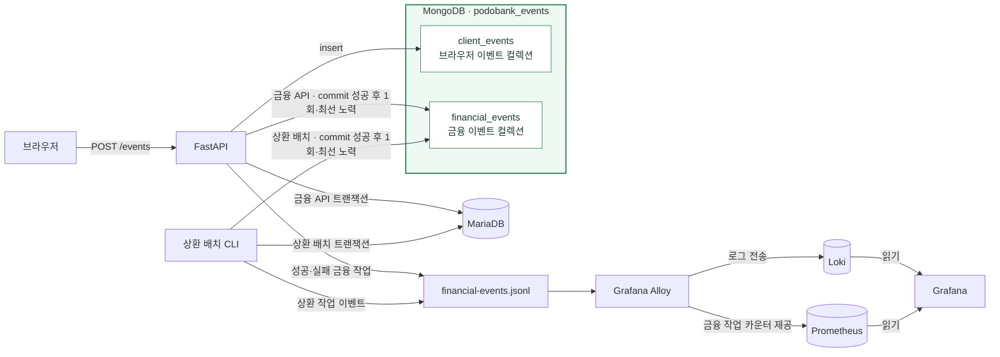

# 관측성과 이벤트 운영 매뉴얼

이 문서는 현재 Docker Compose 구성을 기준으로 Grafana 대시보드, Prometheus 지표, Loki 로그와 MongoDB 이벤트를 확인하는 방법을 설명합니다. 운영 명령은 실행 중인 Compose 프로젝트의 디렉터리, 프로젝트 이름, env 파일과 Compose 파일 조합을 그대로 사용하세요. OCI 프리뷰의 경로와 env 파일 위치는 [Cloudflare Workers 배포 안내](../deployment/npm-preview.md)를 참고하세요.

## 데이터 흐름



Grafana는 Loki와 Prometheus를 조회해 화면에 표시합니다. Grafana가 MongoDB에 이벤트를 쓰지는 않습니다. MongoDB의 두 컬렉션도 서로 별도입니다.

| 저장 위치 | 담기는 내용 | 확인 방법 |
| --- | --- | --- |
| Loki | JSONL 관측 파일에서 수집한 성공·실패 금융 작업 로그 | Grafana 대시보드 또는 Explore |
| Prometheus | Alloy가 JSONL에서 만든 금융 작업 카운터 | Grafana 대시보드 또는 Explore |
| MongoDB `financial_events` | 커밋된 금융 API 작업과 상태를 변경한 상환 배치 CLI 작업의 이벤트 문서 | Compose 안의 `mongosh` |
| MongoDB `client_events` | 브라우저 화면에서 전송한 페이지 방문 및 명시적으로 추적한 UI 이벤트 | Compose 안의 `mongosh` |

## Grafana 열기

Grafana는 서버의 `127.0.0.1:${GRAFANA_PORT:-3000}`에만 바인딩되어 있습니다. OCI 서버에서 볼 때는 로컬 컴퓨터에서 SSH 터널을 열고 브라우저에서 `http://127.0.0.1:3000`으로 접속합니다. 아래 예시는 기본 포트 3000을 사용합니다. `GRAFANA_PORT`를 바꾼 경우 SSH 명령의 원격 포트도 맞춰 주세요.

```sh
ssh -N -L 3000:127.0.0.1:3000 oci-user@oci-host
```

`oci-user@oci-host`를 실제 SSH 계정과 서버 주소로 바꾸세요. 로그인 계정과 비밀번호는 실행 중인 Compose 프로젝트가 사용하는 env 파일(로컬 `.env`, OCI 프리뷰 `.env.npm-preview`)에서 `GRAFANA_ADMIN_USER`와 `GRAFANA_ADMIN_PASSWORD` 설정을 확인하세요. 실제 비밀값은 문서, 터미널 캡처, 이슈나 로그에 붙여 넣지 마세요.

1. **Dashboards → PodoBank → PodoBank Financial Operations**를 엽니다.
2. 기본 시간 범위는 최근 6시간이며 자동 새로고침은 10초입니다. 필요한 시간 범위를 선택합니다.
3. 위 패널은 금융 작업의 초당 변화율을 작업 종류와 성공·실패 결과별로 표시합니다. 아래 패널은 최근 금융 작업 로그를 표시합니다.

대시보드의 지표 쿼리는 다음과 같습니다.

```promql
sum by (operation, outcome) (rate(podobank_financial_operations_total[5m]))
```

이 쿼리는 최근 5분 구간의 초당 작업 변화율입니다. 한 시간 동안 관측된 증가 수를 보려면 Grafana의 Prometheus Explore에서 다음처럼 조회할 수 있습니다.

```promql
sum by (operation, outcome) (increase(podobank_financial_operations_total[1h]))
```

지표의 `operation`에는 `deposit`, `withdrawal`, `transfer`, `loan_application`, `loan_approval`, `loan_rejection`, `repayment_batch`, `manual_loan_repayment`이 사용됩니다. `outcome`은 `success` 또는 `failure`입니다. 실패 이유와 작업 종류는 제한된 값으로 기록됩니다.

최근 금융 작업 로그의 기본 Loki 쿼리는 다음과 같습니다.

```logql
{service="podobank-api"}
```

송금 실패만 보려면 라벨 필터를 추가합니다.

```logql
{service="podobank-api", operation="transfer", outcome="failure"}
```

Prometheus, Loki와 MongoDB는 호스트 포트를 공개하지 않습니다. Grafana를 외부 인터페이스에 공개하거나 이 서비스들의 포트를 인터넷에 열지 마세요. Grafana에는 Prometheus와 Loki 데이터 소스, 대시보드가 Compose 설정으로 미리 제공됩니다.

## MongoDB 이벤트

MongoDB는 Compose 내부에서 FastAPI와 상환 배치 CLI가 직접 사용합니다. MongoDB가 MariaDB에 접속하거나 별도 중계기가 이벤트를 옮기지는 않습니다. 실행 중인 프로젝트의 Compose 컨텍스트에서 `mongosh`를 실행하면 호스트 포트를 공개하지 않고 조회할 수 있습니다.

OCI 프리뷰에서는 배포 안내에서 설명한 기존 env 파일 위치를 사용합니다. 아래 예시의 경로는 실제 서버의 `PREVIEW_ENV_DIR` 값으로 바꾸세요. 로컬 Compose 환경에서는 프로젝트의 기존 env 파일과 옵션을 그대로 사용합니다.

```sh
PREVIEW_ENV_DIR=/path/to/active/preview
COMPOSE_ENV_FILE="$PREVIEW_ENV_DIR/.env.npm-preview.db" \
docker compose --project-name podobank \
  --env-file "$PREVIEW_ENV_DIR/.env.npm-preview" \
  -f compose.yaml -f compose.npm-preview.yaml \
  exec mongo mongosh podobank_events --quiet --eval \
  'db.adminCommand({ ping: 1 })'
```

`podobank_events`는 현재 기본 `MONGO_DB_NAME`입니다. 환경에서 다른 데이터베이스 이름을 설정했다면 그 값을 사용하세요.

### `financial_events`: 커밋된 금융 작업

금융 API 작업이 성공해 MariaDB 트랜잭션이 커밋되면 FastAPI가 `financial_events` 컬렉션에 이벤트 문서를 한 번 직접 기록하려고 시도합니다. 상환 배치 CLI도 상태가 변경된 작업을 MariaDB에 커밋한 뒤 같은 `LoanService`를 통해 이벤트를 기록합니다. 문서에는 이벤트 ID, 스키마 버전, 시각, 작업 종류, 결과와 제한된 사유가 포함됩니다. 상환 배치에는 처리·납부·연체·건너뜀 건수와 배치 ID도 포함될 수 있습니다. 고객·계좌 식별자나 거래 금액은 이 문서에 넣지 않습니다.

이 저장은 최선 노력 방식입니다. outbox, 중계기, 재시도와 재생은 없습니다. MongoDB 기록이 실패해도 이미 커밋된 금융 작업은 성공으로 유지되며, 해당 이벤트가 누락될 수 있습니다. 실패한 금융 작업 시도는 MongoDB `financial_events`에 기록되지 않고 JSONL 관측 경로에 기록됩니다.

최근 금융 이벤트를 읽기 전용으로 조회하는 예시입니다.

```sh
PREVIEW_ENV_DIR=/path/to/active/preview
COMPOSE_ENV_FILE="$PREVIEW_ENV_DIR/.env.npm-preview.db" \
docker compose --project-name podobank \
  --env-file "$PREVIEW_ENV_DIR/.env.npm-preview" \
  -f compose.yaml -f compose.npm-preview.yaml \
  exec mongo mongosh podobank_events --quiet --eval \
  'db.financial_events.find({}, {_id:1, schema_version:1, timestamp:1, event:1, operation:1, outcome:1, reason:1, processed:1, paid:1, overdue:1, skipped:1, batch_id:1}).sort({timestamp:-1}).limit(20).toArray()'
```

### `client_events`: 브라우저 이벤트

화면 경로를 이동하면 프런트엔드가 `page_view` 이벤트를 자동 전송합니다. 다른 이벤트는 화면 코드에서 공통 `trackEvent` 함수를 호출할 때 전송됩니다. 브라우저는 FastAPI의 `POST /events`를 호출하고, API가 형식을 확인한 뒤 MongoDB `client_events`에 저장합니다. 이 저장은 금융 거래와 연결되지 않습니다.

문서에는 이벤트 ID와 종류, UTC 발생 시각, 익명 ID와 세션 ID, 페이지 경로·리퍼러, 이벤트 속성, 스키마 버전이 포함됩니다. MongoDB가 수신 시각 `received_at`을 추가합니다. 페이지 경로와 리퍼러에서 쿼리 문자열과 fragment는 제거됩니다. 이벤트 속성은 사용 사례에 따라 바뀔 수 있으므로 예시 조회에서는 임의 속성 전체를 출력하지 않습니다.

최근 브라우저 이벤트의 일부 필드만 읽는 예시입니다.

```sh
PREVIEW_ENV_DIR=/path/to/active/preview
COMPOSE_ENV_FILE="$PREVIEW_ENV_DIR/.env.npm-preview.db" \
docker compose --project-name podobank \
  --env-file "$PREVIEW_ENV_DIR/.env.npm-preview" \
  -f compose.yaml -f compose.npm-preview.yaml \
  exec mongo mongosh podobank_events --quiet --eval \
  'db.client_events.find({}, {_id:1, type:1, occurred_at:1, "page.path":1, "props.route_name":1, schema_version:1, received_at:1}).sort({occurred_at:-1}).limit(20).toArray()'
```

`client_events`에는 브라우저가 만든 익명·세션 식별자와 UI 이벤트 속성이 포함됩니다. `POST /events`에는 로그인 인증이 없으며 CORS는 브라우저 이외의 호출자를 인증하지 않습니다. 비밀번호, 인증 정보, 실명, 전화번호, 계좌번호, 고객 정보나 실제 금융 데이터를 이벤트 속성에 넣지 마세요.

## 보존 기간과 저장 공간

| 데이터 | 현재 보존 설정 |
| --- | --- |
| Loki 로그 | 720시간(30일) |
| Prometheus 지표 | 15일 |
| MongoDB 두 이벤트 컬렉션 | TTL 만료나 자동 삭제 설정 없음 |
| `financial-events.jsonl` 원본 볼륨 | 자동 삭제 설정 없음 |

MongoDB 데이터는 `mongodb_data` named volume에 남습니다. 이벤트를 지우기 위해 `docker compose down -v`를 실행하지 마세요. 이 명령은 이벤트 이외의 데이터 볼륨도 제거할 수 있습니다. 보존 정책이나 정리 작업을 바꾸려면 별도 변경 계획을 세우세요.

## 문제가 생겼을 때

- **Grafana에서 데이터가 안 보여요.** 대시보드 시간 범위를 넓히고, `docker compose ps`로 현재 프로젝트의 API·Alloy·Loki·Prometheus·Grafana 상태를 확인하세요.
- **금융 작업 로그가 안 보여요.** Grafana Explore에서 Loki 데이터 소스와 `{service="podobank-api"}`를 선택하세요. 이벤트 파일을 Alloy가 읽는 구성과 볼륨을 바꾼 경우에는 Compose 설정과 컨테이너 로그를 확인하세요.
- **금융 작업 지표가 안 보여요.** Grafana Explore에서 Prometheus 데이터 소스를 선택하고 `podobank_financial_operations_total`을 조회하세요. 이 지표는 금융 작업이 실행된 뒤 증가합니다.
- **브라우저 이벤트가 MongoDB에 없어요.** `client_events`를 조회하세요. 브라우저 전송과 API 기록은 최선 노력이며, `POST /events`가 MongoDB 장애를 보고하면 프런트엔드는 화면 동작을 막지 않고 이벤트를 버립니다.
- **성공한 금융 작업이 `financial_events`에 없어요.** `financial_events`는 API 또는 상태를 변경한 상환 배치 CLI 작업을 커밋한 뒤 MongoDB에 한 번 시도하는 최선 노력 기록입니다. API 또는 CLI 로그의 `financial_event_mongodb_write_failed` 경고를 확인하세요. 누락 이벤트를 자동 재처리하는 기능은 없습니다.

컨테이너 로그가 필요하면 실행 중인 Compose 프로젝트의 동일한 환경과 파일 옵션으로 다음 명령을 사용합니다.

```sh
docker compose logs --tail=100 api alloy loki prometheus grafana mongo
```

로그나 MongoDB 결과를 공유하기 전에는 비밀값, 사용자 속성과 식별 정보를 제거하세요.
