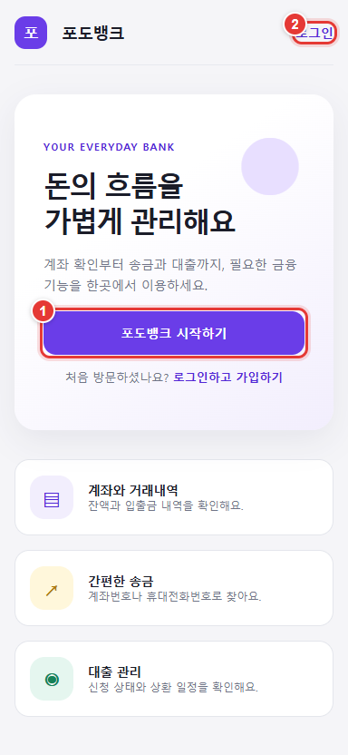
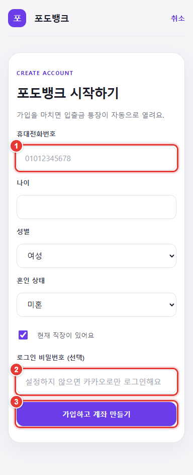
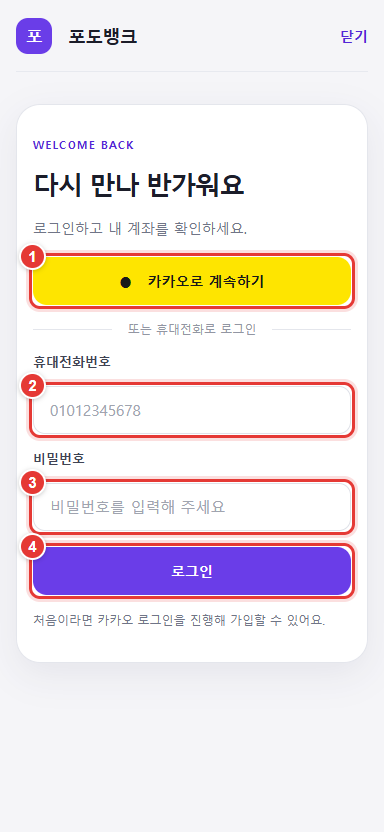
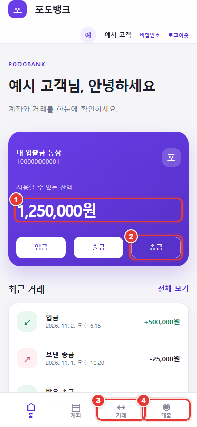
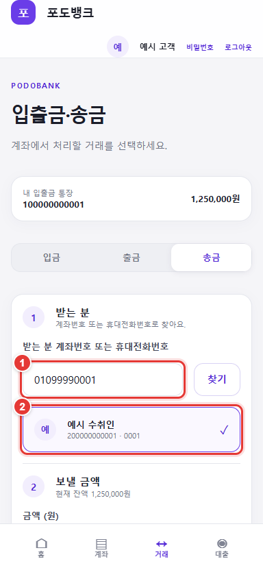
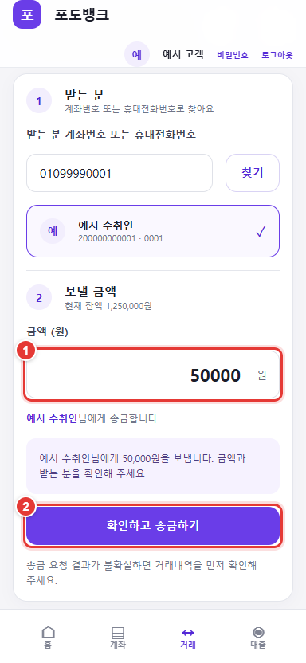
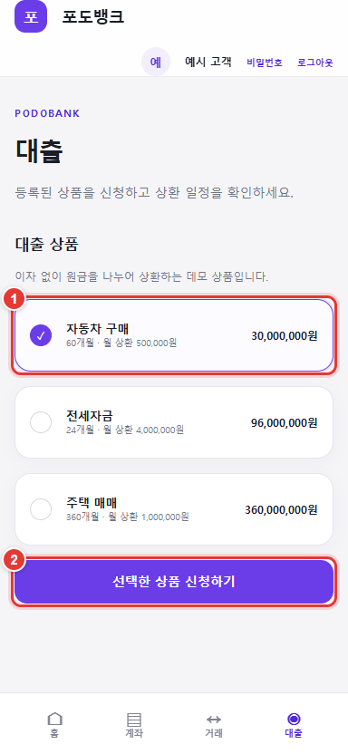
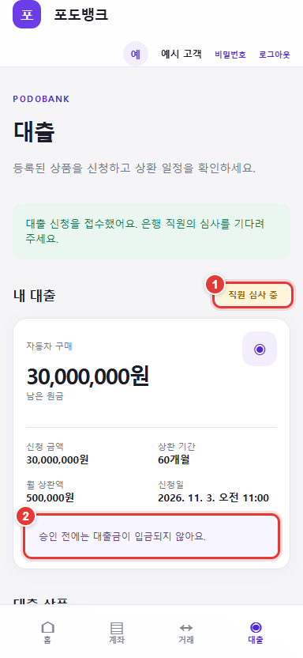
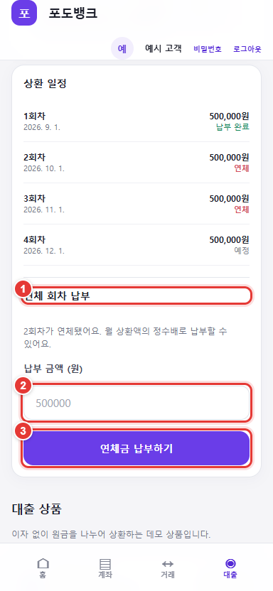
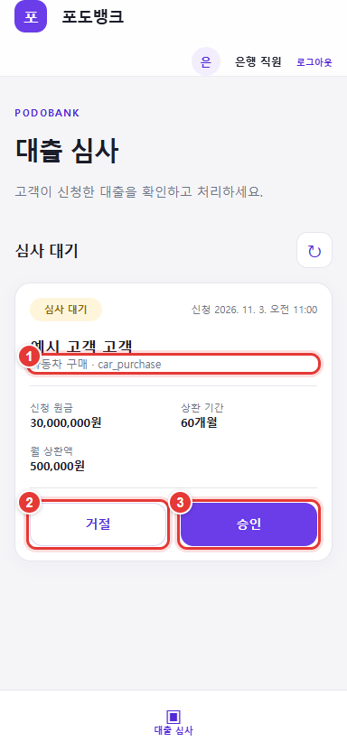

# 포도뱅크 사용자 매뉴얼

## 서비스 접속

[포도뱅크 데모 열기](https://podobank.oci-dev.duckdns.org/)

*그림 1. 처음 이용하면 1번 **포도뱅크 시작하기**, 기존 계정이 있으면 2번 **로그인**을 누릅니다.*

포도뱅크는 포트폴리오용 가상 은행 데모입니다. 화면에서 처리하는 입금, 출금, 송금과 대출은 데모 데이터에 반영되며 실제 금융기관 계좌와 연결되거나 실제 돈이 이동하지 않습니다. 실제 계좌번호, 카드 정보, 금융 비밀번호는 입력하지 말고 테스트용 프로필 정보와 다른 서비스에서 사용하지 않는 비밀번호를 사용하세요.

> 스크린샷의 이름, 번호와 금액은 예시 데이터입니다. 빨간 테두리와 번호는 화면에서 누를 위치와 순서를 나타냅니다.

## 화면 메뉴

고객 계정에는 화면 아래쪽에 **홈**, **계좌**, **거래**, **대출** 메뉴가 표시됩니다. 화면 위쪽의 **비밀번호**에서 휴대전화번호 로그인용 비밀번호를 설정하고, **로그아웃**으로 세션을 종료할 수 있습니다. 은행 직원 계정에는 **대출 심사** 메뉴가 표시됩니다.

| 메뉴 | 할 수 있는 일 |
| --- | --- |
| 홈 | 계좌번호와 잔액, 최근 거래 5건 확인 |
| 계좌 | 계좌번호, 잔액, 거래 내역 확인 및 새로고침 |
| 거래 | 데모 입금, 출금, 계좌 송금 |
| 대출 | 대출 상품 신청, 신청 상태와 상환 일정 확인 |
| 대출 심사 | 직원이 고객의 대출 신청을 승인하거나 거절 |

## 고객으로 이용하기

### 가입하기

1. 서비스에 접속해 **포도뱅크 시작하기**를 누릅니다.
2. 회원가입 화면에서 **전화번호로 가입하기** 또는 **카카오로 가입하기**를 선택합니다.
3. 전화번호로 가입하려면 이름, 휴대전화번호, 나이, 성별, 혼인 상태, 직장 유무와 필수 비밀번호를 입력합니다. 휴대전화번호는 `010-0000-0000`처럼 숫자 3자리-4자리-4자리 형식으로 입력합니다. 비밀번호는 8자 이상이며 확인란에 한 번 더 입력합니다.
4. 전화번호 가입은 SMS 인증을 하지 않으며, 입력한 번호의 소유 여부를 확인하지 않습니다. 실제 번호 대신 데모용 번호를 입력하세요.
5. **가입하고 계좌 만들기**를 누릅니다. 전화번호 가입이 완료되면 기본 입출금 계좌가 자동으로 발급되고 로그인됩니다.
6. 카카오로 가입하려면 카카오 인증을 완료한 뒤 휴대전화번호와 나이, 성별, 혼인 상태, 직장 유무를 입력합니다. 전화번호는 같은 `010-0000-0000` 형식으로 입력하며, SMS 인증은 하지 않습니다. 휴대전화번호 로그인을 원하면 **로그인 비밀번호**를 선택해서 설정할 수 있습니다. 비밀번호를 비워 두면 카카오로만 로그인할 수 있습니다.

*그림 2. 카카오 인증을 마친 뒤 프로필 정보를 작성하는 화면입니다. 전화번호 가입은 회원가입 시작 화면에서 별도 경로를 선택합니다.*

### 로그인과 비밀번호 설정

- 카카오로 가입했다면 로그인 화면에서 **카카오로 계속하기**를 누릅니다.
- 전화번호로 가입했다면 가입할 때 설정한 휴대전화번호와 비밀번호로 로그인합니다.
- 카카오 가입 고객은 가입할 때 비밀번호를 설정했거나 이후 설정을 마쳤다면 휴대전화번호와 비밀번호로 로그인할 수도 있습니다.

*그림 3. 1번은 카카오 로그인, 2~4번은 휴대전화번호와 비밀번호를 사용한 로그인입니다.*

- 카카오로 로그인한 뒤 비밀번호를 추가하려면 화면 위쪽의 **비밀번호**를 누르고 새 비밀번호와 확인란을 입력한 다음 **비밀번호 설정하기**를 누릅니다. 비밀번호 설정 화면은 한 번만 사용할 수 있으며, 이미 설정한 비밀번호를 이 화면에서 변경할 수는 없습니다.

### 잔액과 거래 내역 확인

**홈**에서 계좌번호, 현재 잔액과 최근 거래를 확인합니다. **계좌**에서는 기본 입출금 계좌의 잔액과 거래 내역을 볼 수 있습니다. 거래 내역이 갱신되지 않은 것 같으면 새로고침 버튼을 누릅니다. 거래가 없으면 목록에 아직 거래 내역이 없다는 안내가 표시됩니다.

*그림 4. 잔액을 확인하고, 송금 바로가기나 아래 메뉴를 눌러 다른 화면으로 이동합니다.*

### 입금 또는 출금

1. **거래**로 이동해 **입금** 또는 **출금**을 선택합니다.
2. 금액을 원 단위로 입력합니다. 1원 이상의 금액을 입력해야 합니다.
3. **입금하기** 또는 **출금하기**를 누릅니다.

입금은 데모 계좌 잔액을 늘리는 시뮬레이션입니다. 출금 후 잔액이 부족해지는 요청은 처리되지 않습니다. 완료 화면에서 거래번호와 거래 후 잔액을 확인할 수 있습니다.

### 송금

1. **거래**에서 **송금**을 선택합니다.
2. 받는 분의 계좌번호 또는 휴대전화번호를 숫자 10자리 이상 입력하고 **찾기**를 누릅니다.
3. 검색 결과에서 이름과 표시된 계좌 정보를 확인하고 받는 분을 선택합니다.

*그림 5. 계좌번호나 휴대전화번호를 검색하고, 결과에서 받는 분을 선택합니다.*

4. 보낼 금액을 입력하고 **송금 금액 확인**을 누릅니다.
5. 화면에 표시된 받는 분과 금액을 다시 확인한 뒤 **확인하고 송금하기**를 누릅니다.

*그림 6. 받는 분과 금액을 확인한 뒤 최종 송금 버튼을 누릅니다.*

잔액이 부족하거나 본인 계좌를 받는 계좌로 선택하면 송금이 처리되지 않습니다. 요청 결과가 불확실하면 다시 송금하기 전에 **계좌**의 거래 내역에서 결과를 먼저 확인하세요. 성공하면 거래번호와 거래 후 잔액을 확인할 수 있습니다.

### 대출 신청과 상환

1. **대출**에서 상품별 원금, 기간, 월 상환액을 확인합니다. 상품은 이자가 없는 데모용입니다.
2. 신청할 상품을 선택하고 **선택한 상품 신청하기**를 누릅니다.

*그림 7. 상품의 원금과 상환 조건을 확인하고, 신청할 상품을 선택해 신청합니다.*

3. 신청 상태가 **직원 심사 중**이면 승인 전이므로 대출금이 계좌에 입금되지 않습니다. 심사가 끝나면 **상환 중**, **거절**, **상환 완료** 등의 상태를 확인할 수 있습니다.

*그림 8. 직원 심사 중에는 대출금이 입금되지 않습니다.*

4. 승인된 대출은 계좌에 입금되고 상환 일정이 표시됩니다. 상환은 매월 1일 자동 처리되며, 첫 회차는 승인일에서 한 달이 지난 뒤 처음 돌아오는 1일에 시작됩니다. 잔액이 부족하면 해당 회차 전체가 연체로 표시됩니다.
5. 연체 회차가 있으면 **연체 회차 납부**에서 납부 금액을 입력합니다. 납부 금액은 월 상환액의 정수배여야 합니다.

*그림 9. 월 상환액의 정수배를 입력하고 연체금을 납부합니다.*

심사 중인 대출 또는 상환 중인 대출이 있으면 새 대출을 신청할 수 없습니다. 신청이 거절되거나 대출을 모두 상환한 뒤 다시 신청할 수 있습니다.

## 은행 직원으로 대출 심사하기

직원 계정은 서비스 운영자가 발급합니다. 일반 고객 가입으로 직원 계정을 만들 수 없습니다.

1. 로그인 화면에서 발급받은 휴대전화번호와 비밀번호로 로그인합니다.
2. **대출 심사** 화면에서 심사 대기 목록을 확인합니다. 새 신청이 보이지 않으면 새로고침 버튼을 누릅니다.
3. 고객 이름, 상품, 신청 원금, 상환 기간과 월 상환액을 확인합니다.
4. 결정에 따라 **승인** 또는 **거절**을 누르고 확인 창에서 한 번 더 선택합니다.

*그림 10. 신청 조건을 확인한 다음 거절 또는 승인을 선택하고 확인 창에서 결정합니다.*

승인하면 대출금이 고객 계좌에 입금되고 상환 일정이 생성됩니다. 거절하면 대출금은 입금되지 않습니다. 심사 대기 목록에 신청이 없으면 화면에 대기 중인 신청이 없다는 안내가 표시됩니다.

## 문제가 생겼을 때

- **카카오 로그인이 안 돼요.** 네트워크를 확인한 뒤 로그인 화면에서 다시 시도하세요.
- **휴대전화번호 로그인에 실패해요.** 전화번호 가입 고객은 가입할 때 설정한 비밀번호를 사용하세요. 카카오 가입 고객은 가입 때 비밀번호를 설정하지 않았다면 카카오로 로그인해야 합니다. 직원은 운영자가 발급한 계정 정보를 사용하세요.
- **받는 분을 찾을 수 없어요.** 계좌번호나 휴대전화번호를 숫자만 입력했는지, 10자리 이상인지 확인하세요.
- **송금 결과가 불확실해요.** 다시 요청하기 전에 계좌 거래 내역을 확인하세요.
- **은행 서버에 연결할 수 없다는 안내가 보여요.** 네트워크를 확인하고 로그인 화면에서 다시 시도하세요.
- **직원 대출 심사 메뉴가 보이지 않아요.** 직원 권한이 있는 계정으로 로그인했는지 확인하세요. 고객 계정은 직원 심사를 할 수 없습니다.
